<div align="center">
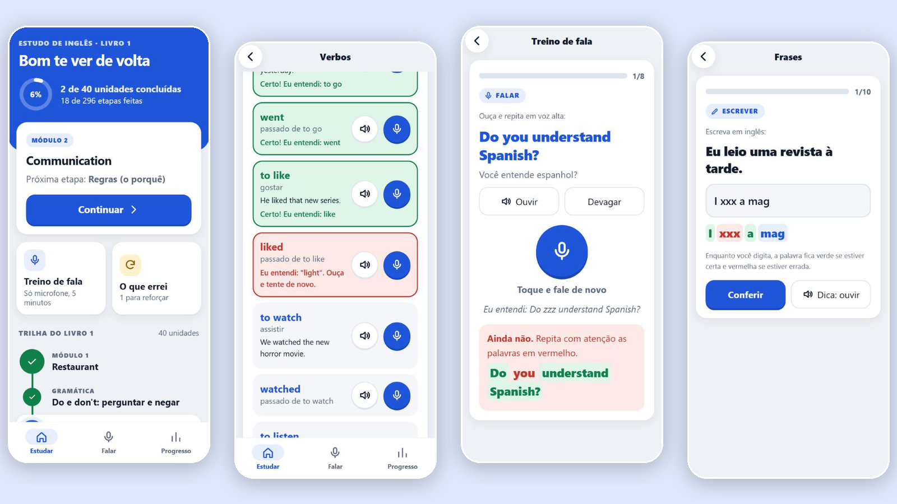
</div>

<div align="center">

# 🎧 Estudo de Inglês

**App de estudo de inglês feito para o celular, centrado em falar: o microfone confere cada palavra que eu digo e a linha fica verde ou vermelha.**
Um arquivo só, sem servidor e sem instalar nada. Conteúdo do livro *Hey, Ho, Let's Go!* (Book 1), em 40 unidades, com o porquê de cada regra explicado.

[](https://victor-ozores.github.io/English-Course/)&nbsp;&nbsp;&nbsp;

&nbsp;

[](https://github.com/victor-ozores/English-Course)&nbsp;&nbsp;&nbsp;

&nbsp;

[](https://app.xperiun.com/in/victor-ozores-2)&nbsp;&nbsp;&nbsp;[](https://github.com/victor-ozores)&nbsp;&nbsp;&nbsp;[](https://www.linkedin.com/in/profissional-victor-ozores/)

</div>

---

## 📌 Resumo

Eu só aprendo um verbo de verdade quando consigo **falar** o verbo do jeito certo. Por isso construí este app em volta do microfone: cada palavra, verbo e frase tem um botão de ouvir e um botão de falar, o app escreve o que entendeu e compara **palavra por palavra** com a frase certa. Acertou, a linha fica verde. Errou, fica vermelha e mostra o que ele entendeu.

O conteúdo vem do livro que estou estudando: 25 módulos e 15 unidades de gramática (do, does, did, will, used to...) que aparecem antes do módulo que precisa delas. Cada unidade segue a mesma ordem, a que eu aprendo melhor: **palavras, verbos, expressões, regras, frases, conversa e revisão**. As regras trazem o professor explicando o porquê (por que o *do* vem antes do verbo, por que o *did* leva o passado e o verbo volta ao normal), a comparação com o português e as pegadinhas que eu mais erro.

Estudo no celular, então o app é uma página só, em tela cheia, com botões grandes, modo escuro e **sem depender de internet para tudo, menos a conferência da fala** (o Chrome precisa de internet para entender a voz). O progresso fica no navegador, em duas cópias, e eu salvo uma terceira em arquivo ou em código, porque o navegador do celular pode apagar os dados sem avisar.

> **É um projeto pessoal de estudo.** O texto do livro é do autor (© Alan Carlos Neves Pereira): por isso o texto do livro **não está neste repositório** (fica só no meu computador) e o site publicado entrega o conteúdo **cifrado**, que só abre com a senha.

## 🔗 Abrir o App

[](https://victor-ozores.github.io/English-Course/)

Abre no Chrome do celular ou do computador. Na primeira vez pede a senha de acesso (o conteúdo vai cifrado); depois ela fica guardada no aparelho. Pelo link do site (https) o Chrome tende a guardar a permissão do microfone, em vez de perguntar a cada toque, como faz com um arquivo aberto do aparelho.

---

## 💡 O Que Ele Responde

* **Eu falei certo?** Cada palavra que o microfone entendeu fica verde; a que não bateu fica vermelha. O verbo precisa sair (*he work* não passa por *he works*; *I can swim* não passa por *I can't swim*).
* **Por que a frase é assim?** Cada regra tem a ideia em uma frase, a fórmula, o porquê, a comparação com o português e os erros mais comuns, que viram pergunta de "qual está certa?".
* **Em que ordem estudar?** A trilha mostra a próxima etapa, e a gramática vem antes do módulo que precisa dela.
* **Onde errei ao escrever?** Enquanto eu digito, cada palavra já fica verde, vermelha ou azul (ainda digitando), antes de apertar em conferir.
* **Perdi meu progresso?** Não: o app guarda duas cópias no navegador e eu salvo uma terceira em arquivo, ou em um código que mando para mim mesmo.

## 🧭 Como Usar

| Quero... | Como |
|---|---|
| **Continuar de onde parei** | Toque em **Continuar** no cartão azul do início. |
| **Aprender um verbo falando** | Etapa **Verbos**: ouça o verbo e a frase de exemplo e fale no microfone de cada linha. Todas verdes = etapa concluída. |
| **Treinar só a fala** | Aba **Falar**: repetir vendo a frase, falar sem ler (do português para o inglês) ou só verbos. |
| **Escrever sem fone** | Nas perguntas de fala, toque em **Escrever esta frase**. As palavras ficam verdes ou vermelhas enquanto eu digito. |
| **Ver o que eu errei** | **O que errei** no início: reúne o que errei e ainda não acertei de novo. |
| **Salvar meu progresso** | Aba **Progresso**: baixar arquivo, compartilhar (Drive, WhatsApp) ou copiar um código. Importar volta tudo, inclusive em outro aparelho. |

## 🖼️ Preview

<div align="center">
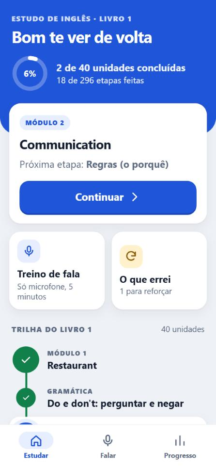&nbsp;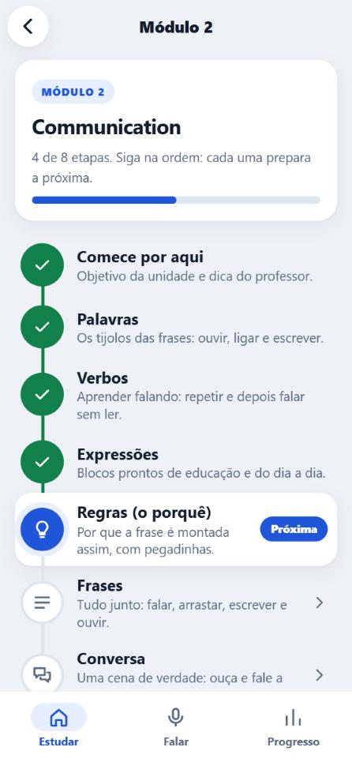&nbsp;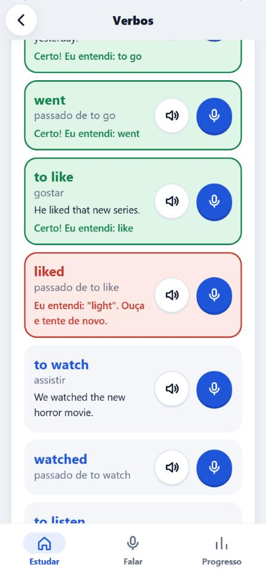
<br><br>
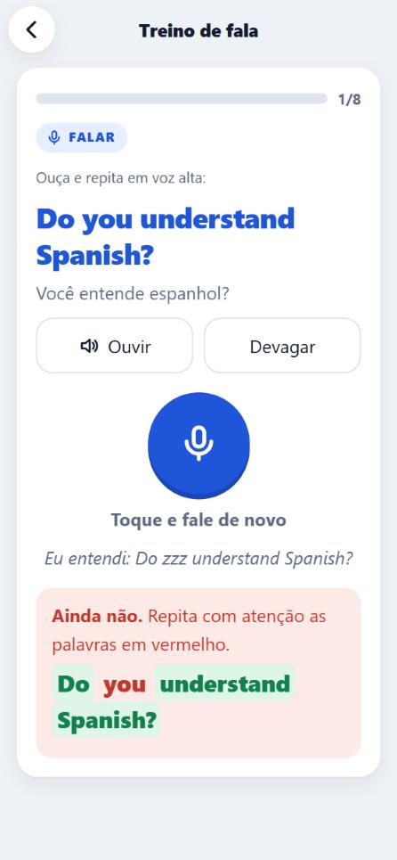&nbsp;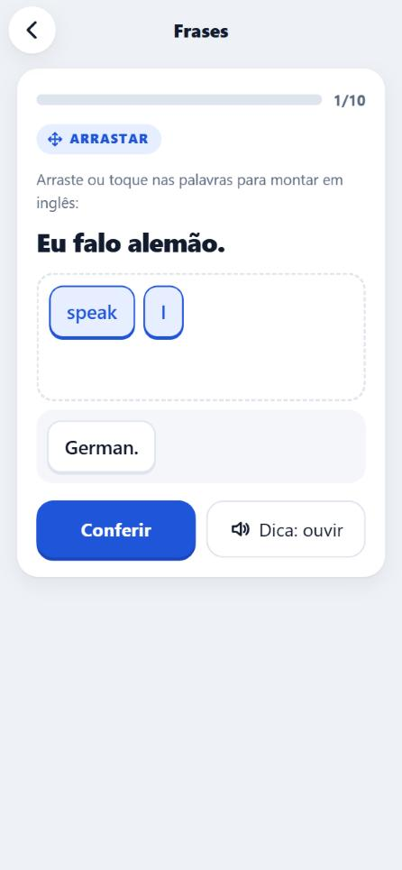&nbsp;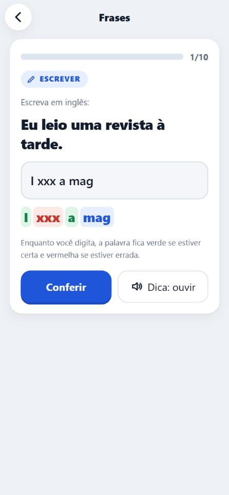
<br><br>
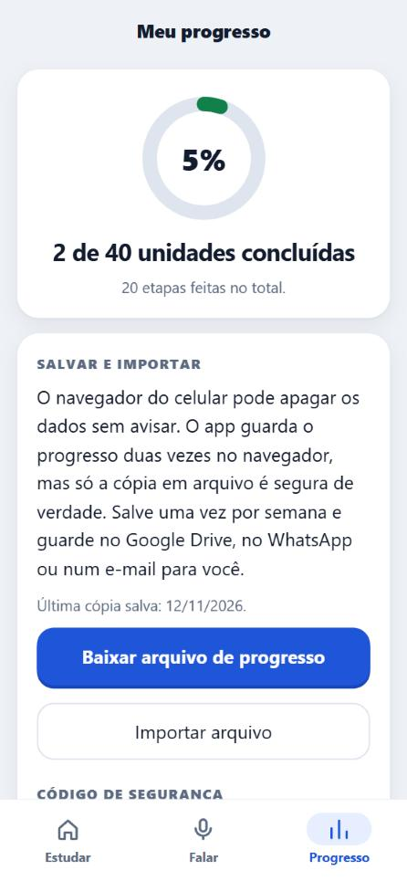&nbsp;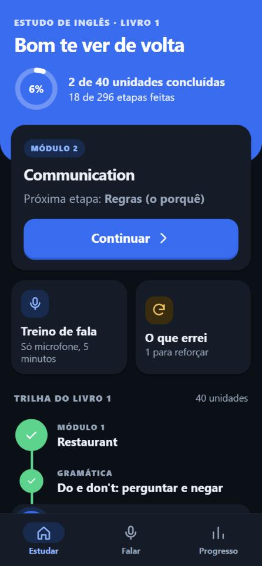
</div>

---

## 🧩 O Que Tem Em Cada Tela

| Tela | O que mostra |
|---|---|
| **Início** | Progresso do livro, o botão Continuar, o treino de fala, o reforço do que errei e a trilha das 40 unidades (gramáticas em âmbar) |
| **Unidade** | As etapas na ordem (**comece por aqui, palavras, verbos, expressões, regras, frases, conversa, revisão**), com a próxima destacada |
| **Palavras e verbos** | Uma linha por item com ouvir e falar; o placar de certas, erradas e faltam; e a rodada de treino |
| **Exercícios** | Falar, falar sem ler, arrastar e montar a frase, completar arrastando, ligar os pares, escrever, ouvir e escrever, escolher e "qual está certa?" |
| **Falar** | Treino só de microfone, com frases da unidade atual ou de tudo o que já estudei |
| **Progresso** | Unidades concluídas, salvar e importar (arquivo ou código), velocidade da voz e reforço |

## 🔄 Como Funciona

O conteúdo mora em arquivos de texto simples, um por unidade. Um script junta tudo em **uma página só**. A versão para o celular sai com o conteúdo **cifrado**, e o navegador decifra com a senha.

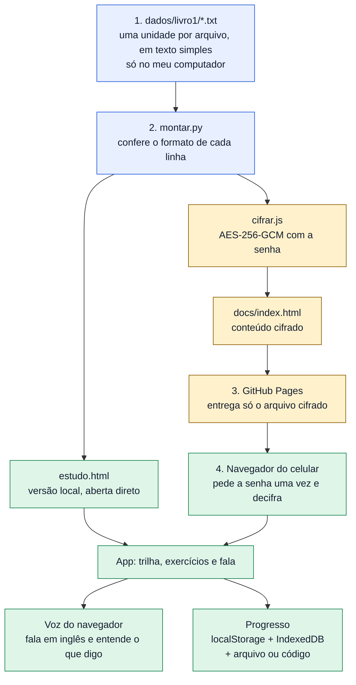

### Uma rodada de exercícios, passo a passo

Uma rodada tem 10 a 12 perguntas, de tipos misturados. O que eu erro volta duas perguntas depois; o que eu acerto só com dica ou depois de 3 tentativas volta no fim e **não conta como "de primeira"**. A etapa fecha com 70% certas de primeira.

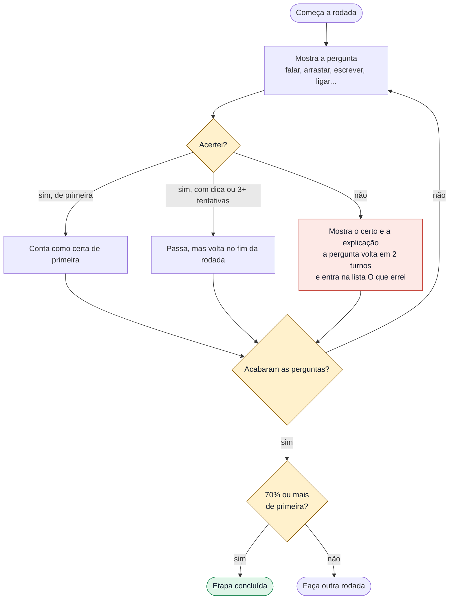

---

## 📚 De Onde Vem o Conteúdo

* **O livro.** *Hey, Ho, Let's Go!* Book 1: palavras, verbos, expressões, frases e conversas dos 25 módulos.
* **O porquê das regras.** As explicações, os exemplos e as pegadinhas das 40 unidades foram escritas para eu entender de verdade, em português simples. As 15 gramáticas (do/don't, have to, to be, does, would like, can, present continuous, did, was/were, passado irregular, if, going to, will, used to) vêm antes do módulo que usa cada uma.
* **O que eu corrigi no livro.** Revisei todas as frases em inglês e corrigi **115** que estavam erradas ou pouco naturais (por exemplo, *in the movies* virou *at the movies*, *fight judo* virou *do judo*, *make a tour* virou *take a tour*). A lista com o antes e o depois fica no meu computador, junto com o conteúdo.

## 🧮 Como a Fala é Conferida

O navegador entende a minha voz e devolve um texto; a comparação com a frase certa é feita por [`src/fala.js`](src/fala.js), que não depende da tela.

* **Toda palavra importante tem de sair, na ordem:** o verbo, *do/does/did*, *not*, *to*, a preposição. É o que faz *he work* e *can't* no lugar de *can* não passarem.
* **Só um artigo pode faltar ou sobrar** (*a, an, the*), e só em frase de 4 palavras ou mais.
* **Valem como certos:** *don't* e *do not*, *15* e *fifteen*, *postcard* e *post card*, e as palavras de mesmo som (*to, too, two*; *read, red*).
* **Verbo sozinho** (*to talk*): o *to* do começo pode faltar, o verbo não.
* **Dica ou 3 tentativas ou mais:** a frase passa, mas volta no fim da rodada.
* **Escrita:** *do not* vale por *don't* e *15* por *fifteen*, mas a grafia tem de estar certa. Enquanto digito, cada palavra fica verde (certa), vermelha (errada) ou azul (ainda digitando).
* **Sem o reconhecimento de voz** (navegador sem suporte), o app grava a minha voz e eu comparo com o modelo. Se também não houver microfone, ele pede para eu escrever a frase.

## ✅ Como Conferi

| O quê | Como | Resultado |
|---|---|---|
| **A conferência da fala e da escrita ao vivo** | [`testes/fala.test.js`](testes/fala.test.js): frases que têm de passar e frases que não podem passar (*he work*, *can't* no lugar de *can*, verbo errado, falta de *did*, ordem trocada) | 50 testes, todos passando |
| **O formato do conteúdo** | `python montar.py` confere cada linha dos 40 arquivos (colunas, tipos de lição, seções) antes de montar | 0 avisos |
| **As telas e os exercícios** | Rodadas completas dos 10 tipos de exercício num navegador de 375 x 812, em claro e escuro, com um robô que responde certo e errado e um microfone simulado | sem erro no console; 40 unidades e todas as etapas abrem sem texto quebrado |
| **Salvar e importar** | Salvei o código, apaguei o progresso, importei pelo código e pelo arquivo, tentei um código quebrado e um arquivo que não era do app; apaguei só o `localStorage` e conferi que o espelho do navegador devolve o progresso | todos os caminhos funcionaram; o inválido é recusado com aviso |
| **A trava com senha** | Abri a versão cifrada com senha errada (recusa) e certa (abre as 40 unidades); conferi que o arquivo publicado não tem nenhuma frase do livro em texto aberto | 0 frases do livro no arquivo cifrado |
| **As frases do livro** | Li as cerca de 2.500 linhas em inglês e as explicações das 40 unidades | 115 frases corrigidas, mais acentos e termos padronizados numa segunda revisão (13/11/2026) |

## 🧱 Tecnologias

| Parte | O que usei |
|---|---|
| **App** | HTML, CSS e JavaScript simples, sem biblioteca e sem instalar nada (nem npm); uma página só |
| **Voz** | Web Speech API do navegador: síntese (ouvir em inglês) e reconhecimento (entender o que eu digo); gravação com `MediaRecorder` quando não há reconhecimento |
| **Montagem** | Python 3 (`montar.py`), só biblioteca padrão |
| **Cifra** | Node (`cifrar.js`) e a Web Crypto do navegador: AES-256-GCM, chave derivada da senha com PBKDF2-SHA256 (250 mil voltas) |
| **Testes** | `node testes/fala.test.js` |
| **Hospedagem** | GitHub Pages, servindo só a pasta `docs/` |

## 🗂️ Estrutura

```
dados/_modelo.txt    o formato de um arquivo de unidade (o conteúdo do livro, em dados/livro1/, fica só no meu computador e não sobe)
src/                 index.html, style.css, app.js (telas e exercícios), fala.js (conferência da fala)
testes/              fala.test.js
montar.py            confere o conteúdo e gera estudo.html (local) e docs/index.html (cifrado)
cifrar.js            cifra o conteúdo para a versão publicada
docs/                index.html cifrado (é o que o GitHub Pages serve) e as imagens deste README
CLAUDE.md, LEIA-ME.md  mapa do código para manter com pouco esforço e guia de uso
```

## ▶️ Rodar No Seu Computador

Precisa de Python 3 e, para o site cifrado e os testes, de Node. O conteúdo do livro (pasta `dados/livro1/`) não está no repositório: sem ele, o `montar.py` não tem o que montar.

```bash
python montar.py                 # confere o conteúdo e gera estudo.html (abre direto no navegador)
node testes/fala.test.js         # os testes da conferência da fala
python -m http.server 8765       # para abrir em http://localhost:8765/estudo.html
```

Para gerar a versão do site (`docs/index.html`), crie um arquivo `senha.txt` com uma linha (a senha de acesso) e rode `python montar.py` de novo. O `senha.txt` e o `estudo.html` ficam fora do Git (estão no `.gitignore`).

Para mudar uma frase, edito o `.txt` da unidade (o formato está em `dados/_modelo.txt`) e rodo `python montar.py`.

## ⚠️ Limitações

* **A senha protege contra leitura casual, não é um cofre.** O conteúdo vai cifrado no site e só abre com a senha, que fica guardada no aparelho depois da primeira vez. Quem tiver a senha lê tudo. O texto do livro em claro (`dados/livro1/`) está no `.gitignore`: **se um dia ele for commitado, vira público**, porque este repositório é público.
* **O reconhecimento de voz é do navegador.** Funciona no Chrome e no Edge, precisa de internet e de permissão do microfone. Ele confirma que cada palavra foi entendida, mas **não mede sotaque fino**. Na primeira vez, o Chrome pede a permissão; aberto como arquivo local ele pergunta a cada toque, e pelo link do site (https) costuma guardar a resposta (ainda não confirmei no meu celular).
* **Testei com um microfone simulado.** Os testes de tela rodaram num navegador Chromium simulando um celular de 375 x 812, em claro e escuro, com respostas de voz simuladas. **Não testei com a minha voz de verdade, nem em celular de verdade**, nem no Safari ou no Firefox.
* **O navegador do celular pode apagar os dados.** O app guarda duas cópias, mas só o arquivo ou o código que eu salvo é seguro de verdade. A tela inicial avisa quando faz mais de 2 dias sem uma cópia.
* **As frases extras** (8 a 12 por unidade) e o texto das gramáticas foram escritos com ajuda do Claude Code e não passaram por nenhuma outra revisão além da minha.
* **Só o Book 1.** O Book 2 entra criando a pasta `dados/livro2/`; o app mostra o seletor de livro sozinho.

## 🛣️ Próximos Passos

* Testar a fala com a minha voz num celular de verdade e ajustar o que o reconhecimento errar com mais frequência.
* Book 2 do livro.
* Mais gramáticas (must/should, there is/are, passivo).

## 📄 Autoria

Projeto pessoal de estudo, feito por [Victor Ozores](https://github.com/victor-ozores) ([LinkedIn](https://www.linkedin.com/in/profissional-victor-ozores/)). O texto do livro *Hey, Ho, Let's Go!* é de Alan Carlos Neves Pereira (© 2017, revisão de agosto de 2022) e não é redistribuído: o texto não está no repositório e o site entrega o conteúdo cifrado. Usei o Claude Code como ferramenta de desenvolvimento; as decisões, as conferências e o que está escrito aqui são minhas.
